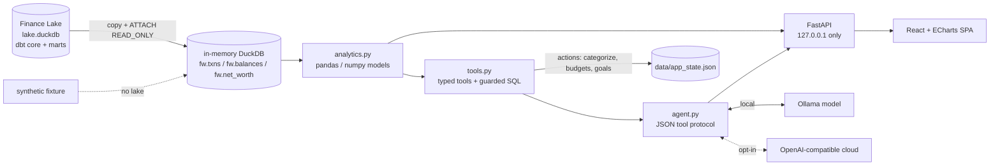
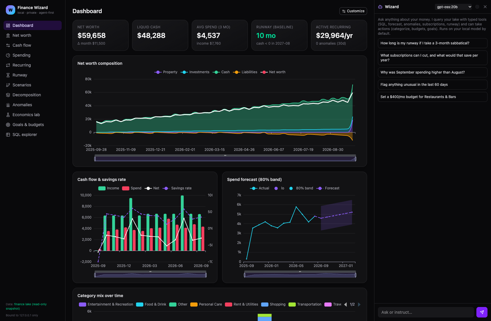
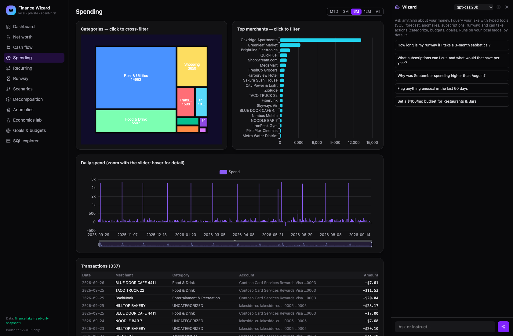
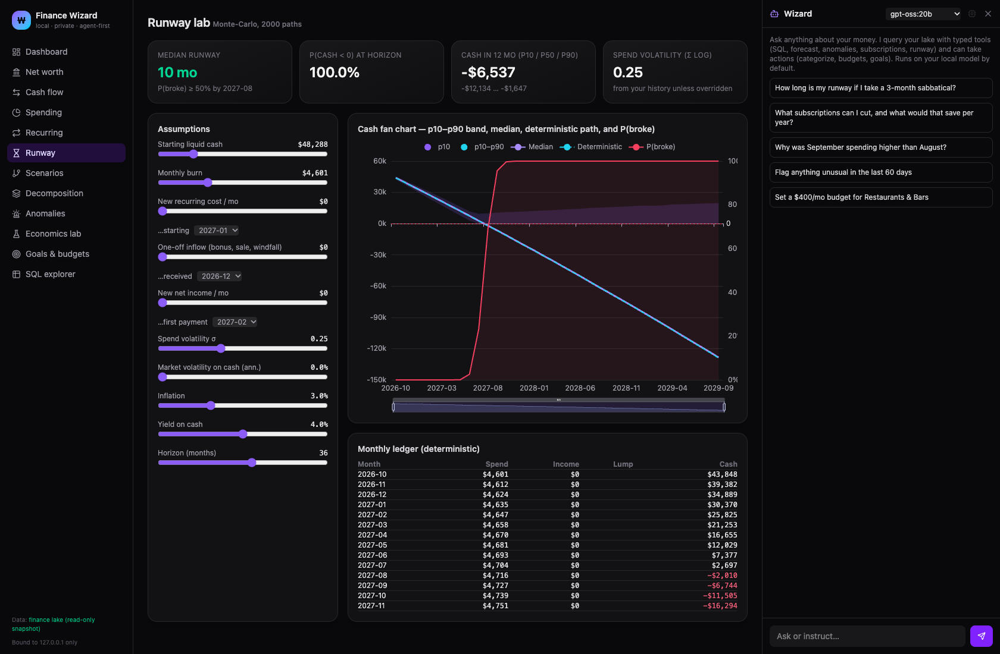
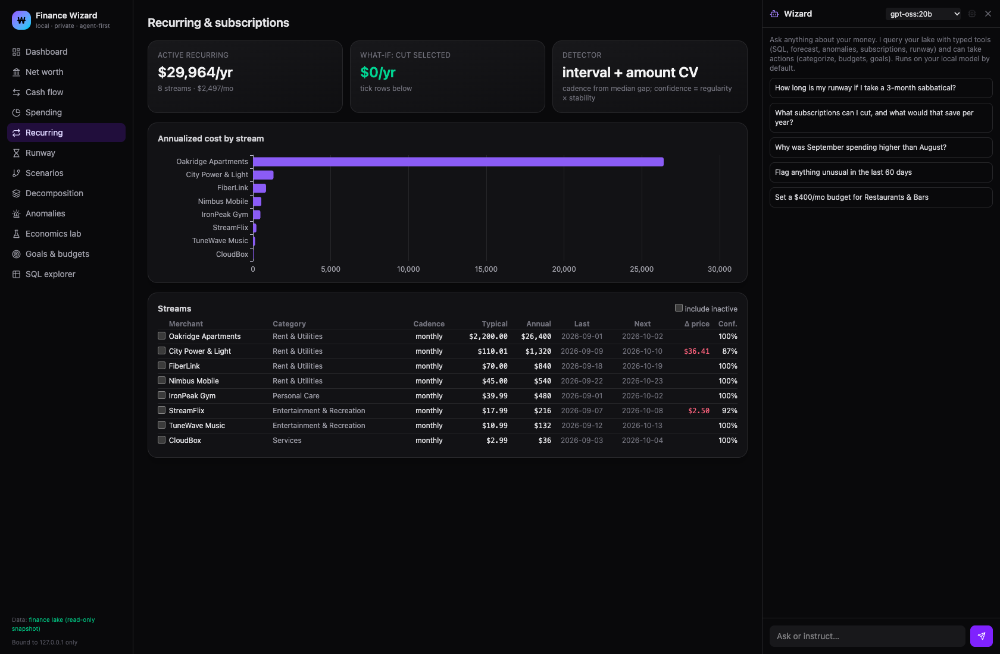

# Finance Wizard

An **agent-first, local-first** personal finance workbench. A tool-using AI analyst sits next to interactive,
economist-grade charts and models, on top of a DuckDB finance lake that it reads **read-only**.

> **All data shown or shipped with this repository is synthetic.** The demo reads the
> [Finance Lake](../finance-lake-demo) (companion repo) sample (a seeded generator with fictional institutions and merchants)
> or a built-in synthetic fixture. Nothing here comes from a real account.

```bash
# sibling checkouts: ./finance-lake-demo and ./finance-wizard-demo
(cd finance-lake-demo && make demo)        # build the synthetic lake (DuckDB + dbt)
(cd finance-wizard-demo && make demo)      # -> http://127.0.0.1:8765  (localhost only)
make fixture                               # or: no lake needed, built-in synthetic fixture
```

Requires `uv`, Node 20+ and `make`. Optional: [Ollama](https://ollama.com) on `127.0.0.1:11434` for the agent
(default model `gemma3:27b`; any local model is selectable in the UI).

## Architecture



## Tech highlights

| | |
|---|---|
| **Agent-first design** | The chat agent plans and calls typed tools (`run_sql` read-only and guarded, `summary`, `spending_by`, `monthly_cashflow` nominal/real, `forecast_spend`, `detect_anomalies`, `detect_subscriptions`, `runway`, `spend_decomposition`) and **actions** (`categorize`, `set_budget`, `add_goal`). Every answer shows its tool trace. A JSON tool protocol works with any Ollama model, including ones without native tool calling. |
| **FastAPI backend** | Pure-function analytics over three canonical views; 30+ endpoints; deterministic tests with a scripted fake model for the agent loop. |
| **React + ECharts UI** | Cross-filtered treemap → merchants → days → transactions, zoomable time series, Monte-Carlo fan charts, waterfalls, configurable dashboard (Vite, Tailwind, TypeScript). |
| **DuckDB, read-only by construction** | The lake file is copied to a snapshot and attached `READ_ONLY`, so the app never contends with ingestion jobs and can't write to it. App state lives in a small JSON store. |
| **Privacy** | Binds to `127.0.0.1` only, no telemetry, the cloud model is off unless configured. |

## What's inside

| Area | What it does |
|---|---|
| **Wizard (agent panel)** | Chat with tool calls and a visible trace; local model by default, optional OpenAI-compatible cloud model via `.env`. |
| **Dashboard** | Configurable widgets (toggle and reorder, persisted locally). |
| **Net worth** | Stacked composition (property / investments / cash / liabilities), zoomable, plus account roll-ups. |
| **Cash flow** | Income vs spend + savings rate, nominal ↔ real (CPI) toggle, click a month to drill in, EWMA + trend forecast with an 80% band. |
| **Spending** | Treemap → merchants → daily → transactions, all cross-filtered by click. |
| **Recurring** | Subscription detector (cadence from median gap, amount stability, regularity) with annualized cost, next expected charge, price creep and a "what if I cut these" calculator. |
| **Runway lab** | Monte-Carlo (2,000 paths) fan chart with p10–p90 band, median, deterministic path and P(broke). Sliders for cash, burn, new recurring costs, one-off inflows, new income, spend and market volatility, inflation and yield. |
| **Scenarios** | Editable, autosaved scenario table with overlaid cash trajectories. |
| **Decomposition** | Month-over-month change in spend as a category waterfall plus a volume vs price split (midpoint/Shapley, additive). |
| **Anomalies** | Robust z-score (median/MAD on log amounts, per category) plus first-time large merchants. |
| **Economics lab** | Real vs nominal (CPI-U), monthly and TTM savings rate, ticket-size distribution, Gini and top-10% share, day-of-week spend, merchant cohorts. |
| **Goals & budgets** | Goals tracked against cash, investments or net worth with required $/mo; budgets with month-to-date pace. |
| **SQL explorer** | Read-only SQL over `fw.txns`, `fw.balances` and the attached `lake.*` catalog. |

## Data

* **Source priority:** Finance Lake dbt models (`core.fact_transaction_enriched`, `core.fact_balance_snapshot` +
  `core.dim_account`, `marts.net_worth`) → built-in synthetic fixture (`backend/fw/fixtures.py`) if no lake is found.
  `FW_LAKE_PATH` points at any lake; the default is a sibling `../finance-lake-demo/lake.duckdb`.
* **Transfers** use the lake's `is_internal_transfer` flag plus payments received on card/loan accounts, and are
  excluded from income, spend and savings rate. Positive amounts outside income categories are **refunds** and net
  against the merchant's usual category.
* `data/`, `.env`, `*.duckdb`, `*.parquet`, `*.csv` are git-ignored.
* CPI: built-in CPI-U annual averages (2025–26 approximate). Drop a BLS monthly CSV at `data/cpi.csv` to override.

## Develop

```bash
make test                                                       # backend tests (+ lake integration test if the lake exists)
cd backend && uv run uvicorn fw.main:app --host 127.0.0.1 --port 8765 --reload
cd frontend && npm run dev                                      # Vite on 127.0.0.1:5173, proxies /api
```

Layout: `backend/fw/{data,analytics,tools,agent,main,cpi,store,fixtures}.py`, `frontend/src/{App,lib}.tsx`,
`pages/*`, `components/Agent.tsx`.

## Docker

```bash
docker compose up --build                                        # synthetic fixture
FW_FIXTURE=0 FW_LAKE_DIR=../finance-lake-demo docker compose up  # synthetic lake, mounted read-only
```

The port is published on `127.0.0.1` only. The chat reaches Ollama on the host via `host.docker.internal`.

## Screenshots

Captured headlessly with `make screenshots` against the synthetic Finance Lake sample (every number is fake).

| Dashboard | Spending |
|---|---|
|  |  |
| **Runway lab** | **Recurring** |
|  |  |

More in [`docs/screenshots/`](docs/screenshots/).

## Roadmap / known gaps
* No holdings/portfolio analytics in the UI yet (the lake has `core.fact_holding_snapshot`).
* Agent answers are only as good as the local model; larger models handle multi-step questions better.

## License

MIT. See [`LICENSE`](LICENSE).
